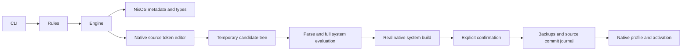

# Architecture and safety boundaries

`core/main.py` and the root compatibility script enter `acenix/cli.py`.
`rules.py` preserves the original reader's line iteration, sections, comments,
boolean rules and first-colon split; it adds typed data and source diagnostics.
It has no NixOS imports and can be reused independently.

`nixos.py` evaluates the real module system and metadata. `engine.py` maps portable
aliases and prepares native edits. `editor.py` is a conservative concrete-syntax
editor: token offsets, balanced delimiters and binding paths determine edits.
It is not a complete Nix parser or an attempt to execute Nix in Python. Unknown
syntax is refused, and Nix parses/evaluates every candidate afterward.

Native planning batches option metadata, current values, temporary type checks,
and package metadata into one evaluation of the selected sources. Candidate
verification uses a separate fresh module graph and groups effective values,
package inclusion/removal checks, warnings, and the system derivation. Native
syntax parsing still runs for each changed file. Doctor combines its derivation
and package checks, falling back to separate queries on failure so diagnostics
retain their individual meaning. No persistent evaluation cache bypasses source
or candidate checks. See [performance measurements](PERFORMANCE.md).

`transactions.py` copies the configuration tree to a private temporary directory,
validates effective requested values and full system derivation assertions, and
builds before asking to commit/activate. Configuration trees are capped at
10,000 files/128 MiB and cannot contain symlinks or non-regular files. Keep
editable imports in that tree. Files in `.git`, `__pycache__` and `.venv` are not
configuration inputs. External/native package sources remain available to Nix
through the selected nixpkgs/channel/locked-flake configuration.

Unreadable regular auxiliary files are recorded with size, inode, timestamps,
permissions and ownership, and omitted from the private candidate with a warning.
They cannot be edited. A real import still fails evaluation, and inaccessible
directories are errors rather than silently incomplete snapshots. Local path
flake source fetching can itself require every source file to be readable.

Atomic replacement is per file, not a filesystem-wide atomic transaction. SHA-256
snapshots detect ordinary external modifications before commit, and a private
advisory lock serializes cooperating AceNix operations. This is optimistic
concurrency control, not protection against a malicious administrator racing
filesystem writes. A durable manifest permits recovery after partial commits or
interruptions. Subsequent external edits are never blindly overwritten during
restoration. Source files retain POSIX permissions and ownership.

Native activation operates on the system path returned by the successful build,
not a fresh evaluation after confirmation. `test` activates without changing the
system profile; `boot` and `switch` set the native system profile first and invoke
its real switch-to-configuration. Activation is gated to NixOS. A failing
activation can have partially changed services/boot/profile state, which is
reported explicitly. The app never silently escalates privileges.

Packages are NixOS `environment.systemPackages` definitions. Only owned
expressions are removable; external list items and expressions are retained.
Ownership, history, profiles and backup journals use private XDG state.
Profile documents are explicit overlays, not wholesale ownership of the machine.

No subprocess uses `shell=True`. CLI values are JSON data or explicitly typed
paths, and all Nix strings escape interpolation. Commands use argument vectors;
no user input is inserted as executable Nix or shell code. Nix itself evaluates
the user's trusted configuration, as with native NixOS administration.

Diagnostics do not fix the machine automatically. Generation rollback, source
recovery, updates and Fastfetch changes are separate explicit operations. The
Fastfetch subsystem preserves ordinary modules and uses a recovery journal.

Generation inspection reads native `system-N-link` symlinks and their timestamps;
it never asks `nix-env --list-generations` to take a writable system-profile lock.
Service discovery retains hidden compatibility names as unavailable without
forcing obsolete aliases that may abort Nix evaluation. Other values are forced
individually inside native `tryEval`; unavailable values remain distinct from false.

Presentation receives real structured command results. JSON bypasses human
formatting and table limits. Human previews keep source diffs behind `--diff`
or `--verbose`; progress callbacks run immediately before actual transaction
steps and are disabled for JSON and quiet mode. No progress percentage or
diagnostic health value is simulated.

The generic backend handles static options and attrsOf submodule children. It
does not claim to rewrite arbitrary functions, modules, dynamic keys, priorities,
or executable option values. List-index option addressing, remote target
activation, remote flake checkout management, arbitrary flake output schemas,
and bootloader-specific default discovery beyond supported systemd-boot/GRUB
metadata are unsupported.
